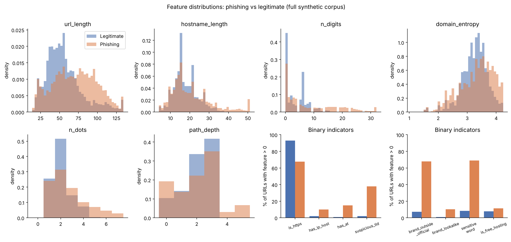
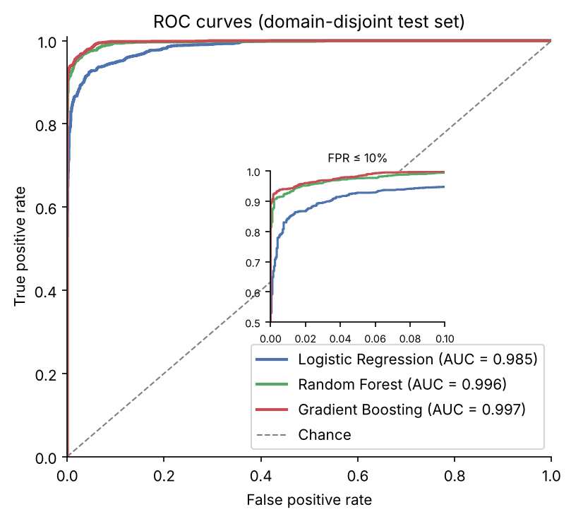
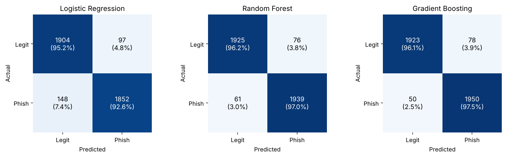
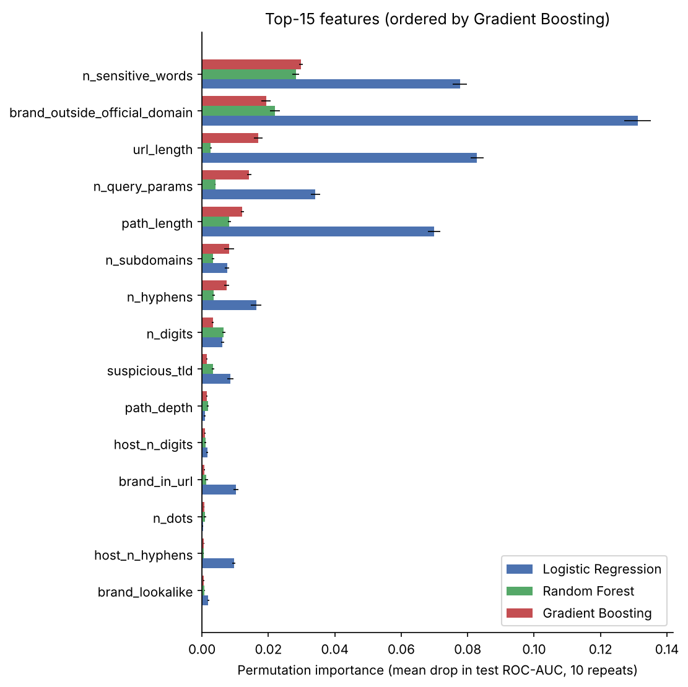
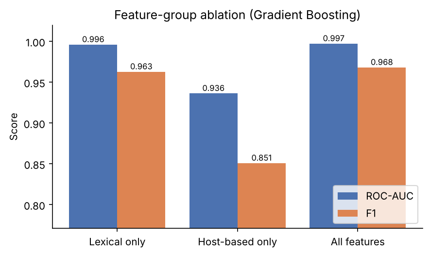
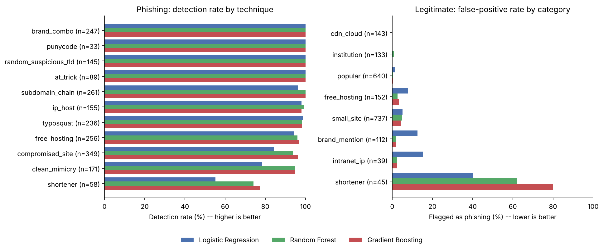
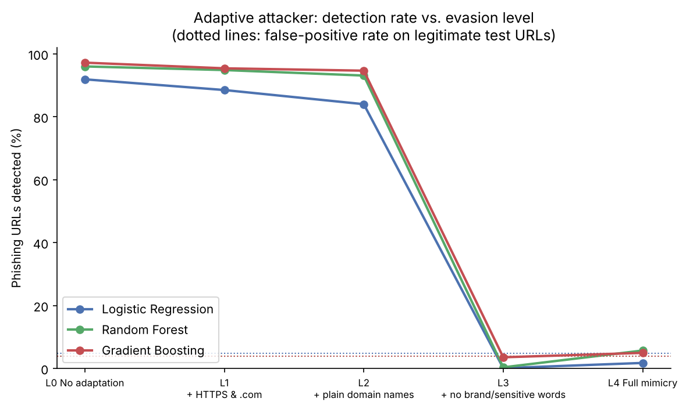

# Lexical URL Features for Phishing Detection: Strong In-Distribution Scores, Weak Transfer, and Easy Evasion

*Research mini-project. Every number and figure in this paper is produced by
`python run_pipeline.py --external` (seed 42) and can be found in
[`results/`](../results/).*

---

## Abstract

Phishing remains one of the most common initial-access vectors in cyber
attacks. Detectors that look only at the URL string are attractive because
they are fast, private and need no network access. We build such a
detector from 25 lexical and host-based features and compare logistic
regression, random forest and gradient boosting. Public phishing/benign corpora were not
downloadable from our build environment, so the models are trained on a
deterministic synthetic corpus of 20,000 URLs. Both classes come from one
generator that implements eleven documented phishing techniques and eight
categories of legitimate URLs, including deliberate hard cases. On a
domain-disjoint test set, gradient boosting reaches 0.968 accuracy, 0.968 F1
and 0.997 ROC-AUC (random forest: 0.966 / 0.966 / 0.996; logistic regression:
0.939 / 0.938 / 0.985). Three further experiments qualify these numbers.
(i) On 5,000 *real* phishing URLs from a public feed, recall falls to
39–41%. Only 37.5% of real phishing URLs carry any "textbook" indicator,
against 90.3% of synthetic ones. (ii) An adaptive attacker who leaves brand
names and login-type words out of the URL lowers detection from about 95% to
0.1–3.6%, at or below the false-positive rate on legitimate URLs. (iii) At a
realistic 1% phishing prevalence, the best model's 3.9% false-positive rate
gives a precision of only about 0.20. We conclude that string-only features
are a useful cheap first layer against unsophisticated phishing. They are
not a robust defence, and high accuracy on curated or synthetic benchmarks
says little about real-world performance.

---

## 1. Introduction

Phishing pages impersonate trusted organisations to harvest credentials,
payment data or session tokens. The Anti-Phishing Working Group (APWG)
regularly records hundreds of thousands to more than a million unique
phishing attacks per quarter [1], and phishing remains a leading initial
access technique in incident reports. The URL is often the first artefact a
defender sees: it appears in an e-mail, SMS or chat message before anyone
clicks.

Blocklists such as PhishTank or Google Safe Browsing are precise, but they are
reactive. A URL must first be reported and verified, and most phishing sites
live only hours to days [9, 10]. Machine-learning classifiers over URL
features promise to generalise to *unseen* phishing URLs [2, 5, 7]. Features
computed from the URL string alone have attractive engineering properties:
they need no DNS or WHOIS lookups or page fetches, so they are fast,
work offline, and leak nothing about the user's browsing to third parties.

This project asks three questions:

1. **RQ1 – Accuracy:** how well do standard models separate phishing from
   legitimate URLs using lexical and host-based string features, under a
   split in which test domains are never seen in training?
2. **RQ2 – Explanation:** which features drive the decisions, and which
   kinds of URLs are misclassified?
3. **RQ3 – Robustness:** how far does performance fall (a) on real phishing
   URLs from a public feed and (b) against an attacker who knows the
   features and avoids them?

**Contributions.** (1) A modular, dependency-light Python implementation
with a 25-feature extractor and a one-command reproducible pipeline.
(2) A documented synthetic URL generator with per-URL technique labels,
which enables per-technique error analysis. (3) A comparison of three
classifiers with base-rate-aware metrics. (4) Two stress tests, an external
recall check on real phishing URLs and a five-level adaptive-attacker
experiment, which together show how much in-distribution scores overstate
real-world performance.

---

## 2. Background and Related Work

### 2.1 Phishing attacks and URL tricks

A phishing URL must persuade a human, and sometimes a filter, that it
belongs to a trusted party. The classic tricks that recur throughout the
literature [3, 4, 11, 12] are:

* **Raw IP-address hosts** (`http://203.0.113.5/paypal/login.php`), which
  avoid buying a domain.
* **The `@` userinfo trick**: in `http://www.paypal.com@evil.tk/`, everything
  before `@` is a username and the browser connects to `evil.tk` [3].
* **Long subdomain chains** that put the brand on the left
  (`paypal.com.secure-login.evil.tk`), so it shows in a truncated address
  bar.
* **Typosquatting and homoglyphs** (`paypa1.com`, `rnicrosoft.com`), and IDN
  homograph attacks using punycode (`xn--...`) [11, 12].
* **Cheap or free top-level domains** (.tk, .ml, .xyz, .top, …), which are
  heavily over-represented in phishing statistics [13].
* **Brand + keyword domains** (`secure-amazon-update.info`).
* **URL shorteners**, which hide the destination.
* **Free hosting and app platforms** (`*.web.app`, `*.github.io`,
  `*.pages.dev`), which provide a reputable parent domain and free TLS.
* **Compromised legitimate websites**, where a kit is uploaded into e.g.
  `/wp-content/plugins/`, so the domain itself is benign and aged.

Defenders have adapted, and so have attackers. Since free certificate
authorities appeared, HTTPS is no longer a useful trust signal, and APWG has
reported that most phishing sites now use it [1]. Studies of blocklists
show that attackers actively engineer evasion against them [9].

### 2.2 URL-based detection

Garera et al. [3] were among the first to classify phishing URLs from
structural features (obfuscation type, hostname tokens, page rank). Ma et al. [2]
showed that large bags of lexical tokens plus host-based features (WHOIS,
DNS, geolocation) allow accurate classification of malicious URLs. They
popularised the distinction between *lexical* features (from the string) and
*host-based* features (properties of the host, usually obtained via network
lookups). In this project "host-based" means features derived from the
*hostname string* (IP host, subdomain count, TLD, entropy, look-alikes), not
network lookups. Mohammad, Thabtah and McCluskey [4] defined a widely used
rule-based feature set (IP address, `@`, long URL, prefix-suffix hyphen,
subdomain count, HTTPS, …) and released the UCI "Phishing Websites"
dataset. More recent corpora such as PhiUSIIL [8] provide hundreds of
thousands of labelled URLs.

### 2.3 Machine-learning approaches

Classical models over hand-crafted features (logistic regression, SVMs,
decision trees, random forests [14] and gradient-boosted trees [15, 16])
routinely report accuracies above 95% on these benchmarks; Sahingoz et al.
[5] report around 98% with random forests and NLP-style features. Deep models
learn features directly from characters and words: URLNet [6] uses
character- and word-level CNNs. Surveys [7] note two recurring weaknesses:
(i) datasets are often collected from different sources per class and at
different times, which inflates accuracy, and (ii) robustness against
adaptive attackers is rarely evaluated. Arp et al. [18] call these pitfalls
*sampling bias*, *spurious correlations* and the *base-rate fallacy*.
Adversarial-ML work [19, 20] shows that phishing classifiers can be evaded
by modifying exactly the features they rely on. Our experiments are designed
to measure these effects rather than ignore them.

---

## 3. Methodology

### 3.1 Data

**Source decision.** We first tried the UCI PhiUSIIL dataset [8], the
PhishTank feed and the Tranco top-sites list. All three were blocked (HTTP
403) by the network policy of the build environment. The only reachable
source, the Phishing.Database project [22], lists phishing URLs but no
legitimate ones. Training on real phishing URLs against legitimate URLs from
an unrelated source would create exactly the class-dependent *sampling bias*
warned about in [18]. We therefore generate **both** classes with one
seeded generator (`src/phishdet/data_gen.py`) and use the real feed only as
an external test (Section 3.6).

**Phishing generator.** Each phishing URL is produced by one of eleven
techniques (sampling weights in parentheses): compromised site (16),
typosquat/homoglyph (13), subdomain chain (12), brand + keyword domain (12),
free-hosting platform (12), clean newly-registered-looking domain (9), IP
host (8), random domain on a suspicious TLD (8), `@` trick (4), shortener (4)
and punycode (2). Each technique combines a kit-style path (`/secure/<brand>/signin/`,
`/wp-content/plugins/.../login.php`, hex directories, `/webscr`, …) with an
optional query (`session=<hex>`, `email=<address>`, `token=…`). Overall, 68%
of phishing URLs use HTTPS (Figure 1).

**Legitimate generator.** Eight categories (approximate shares): long-tail small
sites (35%), well-known sites with realistic subdomains and paths (33%),
CDN/cloud-storage URLs with random-looking hosts (9%), projects on
free-hosting platforms (8%), institutions with deep subdomains (7%),
shortener links (3%), news/forum pages that *mention* a brand (3%) and
intranet/router IP addresses (2%). Hard negatives are included on purpose:
18% of small sites use HTTP, a minority use cheap TLDs (.info, .xyz,
.online, .site, .live), names may contain hyphens or digits, real login
pages exist (`/login`, `/account/settings`), and profile paths may contain
`@`.

**Corpus.** 10,000 unique URLs per class (20,000 total, 13,973 distinct
registered domains). The composition per split and technique is in
`results/dataset_summary.csv`, and the corpus with labels, techniques and split
assignments is in `data/synthetic_urls.csv`.

### 3.2 Features

All 25 features are computed from the URL string (`src/phishdet/features.py`).
Registered domains are derived with a built-in subset of the Public Suffix
List [21]. It includes multi-label suffixes (`co.uk`) and *private* suffixes
of hosting platforms (`web.app`, `github.io`), so `alice.github.io` is its own
site, exactly as browsers treat it.

| Group | Features |
|---|---|
| **Lexical (12)** | `url_length`, `n_dots`, `n_hyphens`, `n_digits`, `has_at`, `is_https`, `path_depth`, `path_length`, `n_query_params`, `n_sensitive_words` (login, verify, account, …), `has_double_slash_path`, `brand_in_url` |
| **Host-based (13)** | `has_ip_host` (incl. integer/hex-encoded IPs), `n_subdomains` (excluding `www`), `suspicious_tld`, `domain_entropy` (Shannon entropy of the hostname characters), `hostname_length`, `host_n_hyphens`, `host_n_digits`, `is_shortener`, `is_free_hosting`, `has_port`, `is_punycode`, `brand_outside_official_domain`, `brand_lookalike` |

Two features encode brand knowledge. `brand_outside_official_domain` fires
when one of 30 commonly impersonated brand tokens appears anywhere in the
URL but the registered domain is not one of that brand's official domains.
`brand_lookalike` fires when a hostname token of length ≥ 5 is not a brand
but becomes one after homoglyph normalisation (0→o, 1→l, rn→m, …) or is
within edit distance 1–2 of one. Figure 1 shows class-conditional
distributions of the main features.

*Figure 1 – Distributions of key features for phishing vs legitimate URLs
(full synthetic corpus). Bottom right: share of URLs in which each binary
indicator fires.*

### 3.3 Models

* **Logistic regression (LR):** `log1p` transform → standardisation →
  L2-regularised LR (C = 1).
* **Random forest (RF)** [14]: 300 trees, `min_samples_leaf = 2`.
* **Gradient boosting (GB)** [15, 16]: scikit-learn
  `HistGradientBoostingClassifier`, 300 iterations, learning rate 0.1,
  31 leaves, L2 = 1.

Hyper-parameters were fixed in advance and never tuned on the test set. All
models are from scikit-learn [17]. The decision threshold is 0.5.

### 3.4 Evaluation protocol

**Domain-disjoint split.** With a random split, many URLs from the same site
(e.g. `github.com/...`) land on both sides, which rewards memorising sites.
We instead use `StratifiedGroupKFold` grouped by registered domain and take
one of five folds as the test set. This gives 15,999 training and 4,001
test URLs (49.99% phishing), with **no registered domain shared** between
them (asserted in code). Stability is estimated with grouped 5-fold
cross-validation on the training set. For comparison we also report a
naive stratified random 80/20 split.

**Metrics.** Accuracy, precision, recall, F1, ROC-AUC, average precision,
the confusion matrix, false-positive rate (FPR) and the **precision at 1%
prevalence**,
P = TPR·π / (TPR·π + FPR·(1−π)) with π = 0.01. The last one corrects for
the balanced test set: real traffic is overwhelmingly benign, and ignoring
this is the base-rate fallacy [18, 23].

**Explanation.** Permutation importance [14] on the test set (mean drop in
ROC-AUC over 10 shuffles) for every model, LR coefficients, a feature-group
ablation (lexical only vs host-based only vs all, with GB), and error rates
broken down by phishing technique and legitimate category.

### 3.5 Adaptive-attacker experiment

We generate 2,000 new phishing URLs at each of five levels. Each level adds
cheap constraints on top of the previous one (`src/phishdet/evasion.py`):

| Level | Attacker behaviour |
|---|---|
| L0 | No adaptation (training distribution, fresh seed) |
| L1 | + always HTTPS; suspicious TLDs replaced by .com/.net/.org |
| L2 | + no IP hosts, `@`, shorteners, punycode or ports |
| L3 | + no brand names, look-alikes or sensitive words in host, path or query |
| L4 | Full mimicry: host and path drawn from the *legitimate* small-site generator (e.g. a kit on a compromised site with an ordinary URL) |

Unit tests verify that each level respects its constraints.

### 3.6 External check on real phishing URLs

We draw a deterministic random sample of 5,000 URLs from the
`phishing-links-ACTIVE.txt` list of Phishing.Database [22], pinned to commit
`12a20bf8dd2b`. The file contains about 790,000 entries. Because the feed has
no benign URLs, it measures **recall only**. We also compare feature means
between synthetic and real phishing. **Disclosure:** while setting up the
download, the author looked at 15 randomly chosen feed URLs before writing
the generator. The generator was then frozen. It was *not* changed in
response to the external results; the only later change added category
labels to legitimate URLs, and the generated URLs are byte-identical. Raw
feed URLs are not committed to the repository.

---

## 4. Experiments and Results

### 4.1 Main comparison (RQ1)

**Table 1 – Domain-disjoint test set (n = 4,001).** Source:
`results/metrics_comparison.csv`.

| Model | Accuracy | Precision | Recall | F1 | ROC-AUC | Avg. prec. | FPR | Precision @ 1% prev. |
|---|---|---|---|---|---|---|---|---|
| Logistic Regression | 0.9388 | 0.9502 | 0.9260 | 0.9380 | 0.9852 | 0.9864 | 0.0485 | 0.162 |
| Random Forest | 0.9658 | **0.9623** | 0.9695 | 0.9659 | 0.9956 | 0.9961 | **0.0380** | **0.205** |
| Gradient Boosting | **0.9680** | 0.9615 | **0.9750** | **0.9682** | **0.9974** | **0.9975** | 0.0390 | 0.202 |

**Table 2 – Grouped 5-fold CV on the training set (mean ± std).** Source:
`results/cv_results.csv`.

| Model | Accuracy | F1 | ROC-AUC |
|---|---|---|---|
| Logistic Regression | 0.928 ± 0.014 | 0.928 ± 0.013 | 0.984 ± 0.004 |
| Random Forest | 0.956 ± 0.010 | 0.956 ± 0.010 | 0.995 ± 0.002 |
| Gradient Boosting | 0.960 ± 0.011 | 0.960 ± 0.011 | 0.996 ± 0.002 |

Both tree ensembles clearly beat the linear baseline: about 3 F1 points and
roughly half as many errors (128 and 137 misclassifications for GB and RF vs 245 for LR, Figure 3).
This suggests that interactions matter, e.g. a long URL is suspicious on an
unknown domain but not on a CDN. GB and RF are practically
indistinguishable: their test-set difference (0.0023 F1) is far smaller than
the CV standard deviation (about 0.01). The test scores lie slightly above
the CV means, consistent with ordinary fold-to-fold variation.

The ROC curves (Figure 2) show that when the threshold is set for a 1% FPR, GB
still detects 94.2% of phishing and RF 92.7%, against 84.2% for LR
(`tpr_at_1pct_fpr` in Table 1's source file). Figure 3 shows the
confusion matrices: GB misses 50 of 2,000 phishing URLs and wrongly flags 78
of 2,001 legitimate ones.

*Figure 2 – ROC curves on the domain-disjoint test set; the inset zooms
into FPR ≤ 10%. (Precision-recall curves: `results/figures/pr_curves.png`.)*

*Figure 3 – Confusion matrices at threshold 0.5 (row percentages in
brackets).*

**Random vs domain-disjoint split.** With a naive random split
(`results/metrics_random_split.csv`) the scores are almost unchanged:
GB F1 0.9629 vs 0.9682, ROC-AUC 0.9972 vs 0.9974; RF F1 0.9605 vs 0.9659;
LR F1 0.9329 vs 0.9380. The differences are within CV noise. Our features
describe the *shape* of a URL rather than the identity of its domain, so
there is little domain memorisation to exploit. Grouping is still the
correct protocol. It would matter for token-based models such as bag-of-words [2]
or character CNNs [6], which can memorise domains.

### 4.2 What drives the decisions (RQ2)

**Feature importance.** Figure 4 shows permutation importance. All three
models rely most on two brand/semantics features: `n_sensitive_words`
(GB: 0.030 drop in AUC; RF: 0.028; LR: 0.078) and
`brand_outside_official_domain` (GB: 0.019; RF: 0.022; LR: 0.131). These are
followed by URL/path length and query-parameter count. The largest LR
coefficients (`results/logreg_coefficients.csv`, standardised log1p scale)
tell the same story: `brand_outside_official_domain` +3.07, `url_length` +2.74,
`n_sensitive_words` +2.38. Conditional on total length, `path_length`
(−2.64) and `n_query_params` (−2.19) push towards *legitimate*: for a given
total length, legitimate URLs spend more characters in descriptive paths,
while phishing URLs spend them in the host. The tree ensembles' importances
are smaller in absolute value because many features are redundant, and
permuting one leaves correlated substitutes intact [24]. Several classic
indicators (`has_ip_host`, `has_at`, `is_punycode`) have near-zero
permutation importance for the same reason. They are rare, and URLs that
carry them usually trigger other indicators too.

*Figure 4 – Permutation importance (mean drop in test ROC-AUC, 10 repeats,
error bars = std), top 15 features ordered by Gradient Boosting.*

**Feature-group ablation** (GB, `results/ablation.csv`, Figure 5):

| Feature set | # | Accuracy | F1 | ROC-AUC | FPR |
|---|---|---|---|---|---|
| Lexical only | 12 | 0.9628 | 0.9629 | 0.9962 | 0.0420 |
| Host-based only | 13 | 0.8513 | 0.8510 | 0.9364 | 0.1469 |
| All | 25 | 0.9680 | 0.9682 | 0.9974 | 0.0390 |

Lexical features alone come within 0.5 F1 points of the full model. The
host-based features alone are much weaker. This is partly by design: the
"compromised site" and "clean domain" techniques have entirely benign
hosts, and only the path reveals the attack. Combining both groups gives
the best result.

*Figure 5 – Feature-group ablation with Gradient Boosting.*

**Error analysis by category** (Figure 6, `results/error_by_category.csv`).
GB detects 100% of `@`-trick, brand+keyword, punycode, suspicious-TLD and
subdomain-chain URLs, and 96–98% of typosquat, IP-host, free-hosting and
compromised-site URLs. Clean newly-registered-looking domains (94.7%) and
especially **shorteners (77.6%)** are harder. The shortener result is not
real detection. GB also flags **80% of legitimate shortener links**
(n = 45): a shortened URL carries no information about its destination, so
the model has simply learned "shortener ⇒ probably phishing". In the other
legitimate categories GB's FPR is low: 0% for CDN and institutional URLs,
0.5% for popular sites, 1.8% for articles mentioning a brand, 2.6% for
intranet IPs, 3.3% for free-hosting projects and 4.2% for small sites. LR is
much worse on the hard negatives: it flags 12.5% of brand-mentioning
articles and 15.4% of intranet IPs, and it detects only 78.4% of
clean-domain and 84.2% of compromised-site phishing.

*Figure 6 – Left: detection rate by phishing technique. Right:
false-positive rate by legitimate category (test set, threshold 0.5).*

### 4.3 Robustness (RQ3)

**Real phishing URLs.** On 5,000 real phishing URLs
(`results/external_check.csv`), recall falls to **38.7% (LR), 41.4% (RF) and
40.1% (GB)**, compared with 92.6–97.5% on the synthetic test set. The
feature-shift table (`results/external_feature_shift.csv`) explains the gap:

| Feature (mean) | Synthetic legit | Synthetic phishing | Real phishing |
|---|---|---|---|
| `brand_outside_official_domain` | 0.073 | 0.680 | **0.118** |
| `suspicious_tld` | 0.021 | 0.377 | **0.089** |
| `n_sensitive_words` | 0.087 | 1.129 | **0.348** |
| `has_at` | 0.010 | 0.151 | 0.019 |
| `has_ip_host` | 0.020 | 0.101 | 0.009 |
| `is_https` | 0.929 | 0.677 | 0.771 |
| `is_free_hosting` | 0.078 | 0.115 | 0.157 |
| `url_length` | 56.2 | 70.3 | 83.5 |
| `n_digits` | 3.7 | 9.0 | 13.1 |
| `domain_entropy` | 3.26 | 3.32 | 3.53 |

Real phishing URLs mention a brand, use a suspicious TLD or contain login
words much less often than our generator (and much of the literature)
assumes. Instead, they are longer, contain more digits and have
higher-entropy hostnames. If we define a "classic indicator" as any of IP
host, `@`, suspicious TLD, brand outside its domain, brand look-alike,
punycode or a sensitive word, it fires on **90.3%** of synthetic phishing
URLs but only **37.5%** of real ones (and on 20.7% of synthetic legitimate
URLs). Splitting the real sample by this indicator
(`results/external_check_by_indicator.csv`): GB detects **67.2%** of the
real URLs that have a classic indicator (RF 72.8%, LR 74.3%) but only
**23.8%** of those that do not (RF 22.7%, LR 17.3%). The models have learned
the textbook phishing URL well; most real phishing URLs are not textbook.

**Adaptive attacker** (Figure 7, `results/evasion.csv`):

| Level | LR | RF | GB |
|---|---|---|---|
| L0 No adaptation | 91.9% | 96.0% | 97.2% |
| L1 + HTTPS & .com | 88.5% | 94.9% | 95.4% |
| L2 + plain domain names | 84.0% | 93.1% | 94.7% |
| L3 + no brand / sensitive words | **0.1%** | **0.4%** | **3.6%** |
| L4 Full mimicry | 1.8% | 5.7% | 5.0% |

Infrastructure changes (L1, L2) cost the ensembles only 2–3 points of
detection, because the brand and keyword signals remain. Once the attacker
also keeps brand names and login words out of the URL (L3), detection
collapses to the false-positive rate on legitimate URLs (GB FPR 3.9%) or
below. For LR and RF, L3 URLs are flagged *less* often than legitimate URLs:
they are short, neutral paths such as `/documents/view` on plain domains. The models have learned that "no brand and no login word"
means benign. At L4 phishing URLs are drawn from the legitimate small-site
distribution by construction, so detection is close to the FPR on that
category (GB: 4.2% small-site FPR vs 5.0% L4 detection). Every L3 step is
cheap for a real attacker: a neutral domain name, and a lure that names the
brand in the e-mail or page body rather than in the URL.

*Figure 7 – Detection rate as the attacker adapts to the feature set.
Dotted lines: each model's false-positive rate on legitimate test URLs.*

---

## 5. Discussion and Limitations

**In-distribution accuracy is not the deployment metric.** A ROC-AUC of
0.997 and F1 of 0.968 match the 95–99% figures common in the literature
[4, 5, 8]. Our own stress tests show why such numbers should be read with
care. Three separate factors overstate performance:

1. **Dataset construction.** A corpus encodes its builder's idea of
   phishing. Our generator, like many feature sets, centres on textbook
   indicators. It reached 97.5% recall in-distribution and 40% on a real
   feed. Real-world benchmarks have analogous problems: classes are
   collected from different sources (verified phishing feeds vs top-site
   lists), so the model can learn source artefacts, popularity or age
   instead of maliciousness [7, 18].
2. **Base rates.** Even with a 3.9% FPR, at 1% phishing prevalence only
   about one alert in five is a true phishing URL (precision at 1%: 0.202 for GB,
   0.205 for RF, 0.162 for LR). Making the detector useful as a blocking
   control would need FPRs one to two orders of magnitude lower, e.g. a
   higher threshold, an allow-list for popular domains, or a second-stage
   check.
3. **Adaptive adversaries.** Our evasion experiment did not need gradient
   attacks [19, 20]: a handful of cheap, human-level choices was enough.

**How an attacker evades this detector**, ordered by cost:

* *Free:* use HTTPS (free certificates); avoid `@`, IP hosts and ports.
* *Cheap:* register an ordinary-looking `.com`/`.net` instead of a free
  ccTLD or a hyphenated brand name, or use a free-hosting platform with a
  neutral project name.
* *Cheap and decisive:* keep the brand and login words out of the URL
  (`/documents/view?id=…`) and put the impersonation in the page content or
  e-mail text, which a URL-only model never sees. In our experiment this
  step alone takes detection from about 95% to below 4%.
* *Moderate:* host the kit on a compromised, aged, legitimate website with
  a normal-looking path, or hide it behind a redirect or shortener. The
  URL is then lexically indistinguishable from benign traffic (L4).
* *Feature-specific:* since the brand list and look-alike threshold
  (edit distance ≤ 1–2, tokens ≥ 5 characters) are fixed, an attacker can
  pick a look-alike just outside them (e.g. three edits away), or use a
  brand not on the list.

**Shortener behaviour.** The models flag shortened links largely by the
shortener domain itself, which helps nobody. Shortened links should be
expanded (a network call) or handled by policy rather than scored lexically.

**Heuristic false positives.** Edit-distance look-alike matching flags
honest names: "cloud" is one edit from the brand "icloud", "shopify" two from
"spotify". The model learns to down-weight these features, but they are
noisy, and naive rule-based deployments would generate complaints.

**Limitations.**

* *Synthetic training data.* All in-distribution numbers depend on our
  generator's design choices (technique weights, vocabularies, the share of
  hard cases). They are best read as a controlled comparison of models and
  features, not as an estimate of field accuracy.
* *External check measures recall only.* The real feed has no benign URLs,
  so we cannot measure real-world FPR. The feed may also contain stale or
  mislabelled entries. A single feed snapshot reflects one point in time.
* *Feature scope.* We deliberately excluded network-derived signals (domain
  age, WHOIS, DNS, TLS certificate details, hosting reputation), page
  content and visual similarity. These are harder for attackers to fake
  and are known to improve robustness [2].
* *Model scope.* No hyper-parameter search and no character-level deep
  models [6]. Those models may capture some of the length/digit/entropy
  patterns of real phishing that our features miss.
* *Static evaluation.* No temporal split, so we cannot measure concept
  drift as attacker tactics change.

**Recommendations.** (i) Train and evaluate on real data where both classes
come from the same collection process (e.g. URLs observed in one mail
stream, labelled afterwards), and use time- and domain-disjoint splits.
(ii) Report FPR at realistic prevalence, not only accuracy. (iii) Include
an adaptive-attacker evaluation as standard practice. (iv) Treat
string-only scores as a cheap first stage that decides which URLs get
expensive analysis (content, rendering, reputation).

---

## 6. Conclusion

We built a reproducible phishing-URL detector from 25 lexical and
host-based string features and compared three classifiers. On a
domain-disjoint synthetic test set, the tree ensembles clearly outperform
logistic regression; gradient boosting reaches 0.968 accuracy, 0.968 F1 and
0.997 ROC-AUC. Decisions are driven mainly by brand-outside-official-domain,
sensitive words and URL/path length, and lexical features carry most of
the signal. The stress tests are the more important result. On real phishing
URLs, recall falls to about 40% because most real URLs lack the textbook
indicators. An attacker who simply keeps brand names and login words out of
the URL reduces detection to the false-positive level. At realistic base
rates, four of five alerts are false. String-only models are a fast,
private and useful first filter for unsophisticated phishing, but robust
detection needs content, reputation and infrastructure signals. Evaluations
in this field should routinely include source-consistent data, base-rate
metrics and adaptive attackers.

---

## References

[1] Anti-Phishing Working Group (APWG). *Phishing Activity Trends Reports* (quarterly). https://apwg.org/trendsreports/

[2] J. Ma, L. K. Saul, S. Savage, G. M. Voelker. "Beyond Blacklists: Learning to Detect Malicious Web Sites from Suspicious URLs." *Proc. 15th ACM SIGKDD*, 2009, pp. 1245–1254.

[3] S. Garera, N. Provos, M. Chew, A. D. Rubin. "A Framework for Detection and Measurement of Phishing Attacks." *Proc. ACM Workshop on Recurring Malcode (WORM)*, 2007.

[4] R. M. Mohammad, F. Thabtah, L. McCluskey. "An Assessment of Features Related to Phishing Websites Using an Automated Technique." *Proc. ICITST*, 2012. Dataset: "Phishing Websites", UCI Machine Learning Repository, 2015.

[5] O. K. Sahingoz, E. Buber, O. Demir, B. Diri. "Machine Learning Based Phishing Detection from URLs." *Expert Systems with Applications*, 117:345–357, 2019.

[6] H. Le, Q. Pham, D. Sahoo, S. C. H. Hoi. "URLNet: Learning a URL Representation with Deep Learning for Malicious URL Detection." arXiv:1802.03162, 2018.

[7] D. Sahoo, C. Liu, S. C. H. Hoi. "Malicious URL Detection using Machine Learning: A Survey." arXiv:1701.07179, 2017.

[8] A. Prasad, S. Chandra. "PhiUSIIL: A Diverse Security Profile Empowered Phishing URL Detection Framework Based on Similarity Index and Incremental Learning." *Computers & Security*, 136:103545, 2024.

[9] A. Oest, Y. Safaei, A. Doupé, G.-J. Ahn, B. Wardman, K. Tyers. "PhishFarm: A Scalable Framework for Measuring the Effectiveness of Evasion Techniques against Browser Phishing Blacklists." *Proc. IEEE Symposium on Security and Privacy*, 2019.

[10] S. Sheng, B. Wardman, G. Warner, L. F. Cranor, J. Hong, C. Zhang. "An Empirical Analysis of Phishing Blacklists." *Proc. Conference on Email and Anti-Spam (CEAS)*, 2009.

[11] E. Gabrilovich, A. Gontmakher. "The Homograph Attack." *Communications of the ACM*, 45(2):128, 2002.

[12] J. Szurdi, B. Kocso, G. Cseh, J. Spring, M. Felegyhazi, C. Kanich. "The Long 'Taile' of Typosquatting Domain Names." *Proc. 23rd USENIX Security Symposium*, 2014.

[13] Interisle Consulting Group. *Phishing Landscape: An Annual Study of the Scope and Distribution of Phishing* (2021–2023 editions). https://interisle.net/

[14] L. Breiman. "Random Forests." *Machine Learning*, 45(1):5–32, 2001.

[15] J. H. Friedman. "Greedy Function Approximation: A Gradient Boosting Machine." *Annals of Statistics*, 29(5):1189–1232, 2001.

[16] G. Ke, Q. Meng, T. Finley, T. Wang, W. Chen, W. Ma, Q. Ye, T.-Y. Liu. "LightGBM: A Highly Efficient Gradient Boosting Decision Tree." *Advances in Neural Information Processing Systems 30*, 2017.

[17] F. Pedregosa et al. "Scikit-learn: Machine Learning in Python." *Journal of Machine Learning Research*, 12:2825–2830, 2011.

[18] D. Arp, E. Quiring, F. Pendlebury, A. Warnecke, F. Pierazzi, C. Wressnegger, L. Cavallaro, K. Rieck. "Dos and Don'ts of Machine Learning in Computer Security." *Proc. 31st USENIX Security Symposium*, 2022.

[19] B. Biggio, F. Roli. "Wild Patterns: Ten Years After the Rise of Adversarial Machine Learning." *Pattern Recognition*, 84:317–331, 2018.

[20] H. Shirazi, B. Bezawada, I. Ray, C. Anderson. "Adversarial Sampling Attacks Against Phishing Detection." *Data and Applications Security and Privacy XXXIII (DBSec)*, LNCS 11559, 2019.

[21] Mozilla Foundation. *Public Suffix List.* https://publicsuffix.org/

[22] M. Krog et al. *Phishing.Database* (GitHub repository), file `phishing-links-ACTIVE.txt` at commit `12a20bf8dd2b7e78d9d38fc12b3e5c970f79d1a7`. https://github.com/mitchellkrogza/Phishing.Database

[23] S. Axelsson. "The Base-Rate Fallacy and the Difficulty of Intrusion Detection." *ACM Transactions on Information and System Security*, 3(3):186–205, 2000.

[24] C. Strobl, A.-L. Boulesteix, T. Kneib, T. Augustin, A. Zeileis. "Conditional Variable Importance for Random Forests." *BMC Bioinformatics*, 9:307, 2008.
